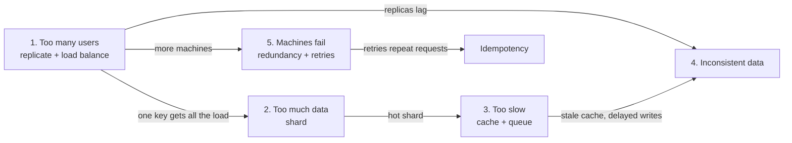
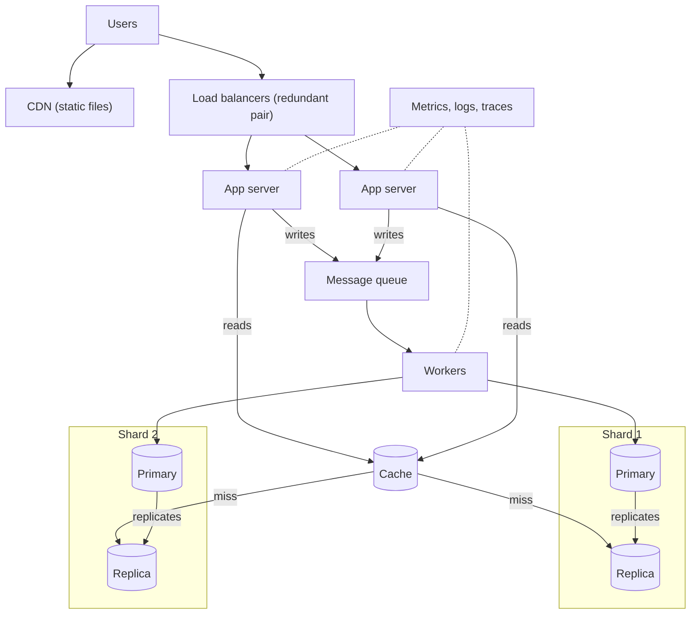

# System design: the five core challenges at scale

!!! abstract "Where it's used in this project"
    The platform is small, but it already meets all five challenges: the API runs 2–10 stateless replicas behind an HPA ([`hpa.yaml`](https://github.com/foyez/dbaas-platform/blob/main/gitops/api/base/hpa.yaml)), creates return `202 Accepted` and the operator finishes the work in the background ([`instance.go`](https://github.com/foyez/dbaas-platform/blob/main/platform/internal/api/handler/instance.go)), and each database is a CloudNativePG cluster with a primary, standbys and failover. This page is the map; the linked pages have the depth. Overview: [Learning notes](index.md).

## Key ideas

### Overview

Once traffic or data outgrows one machine, most system design problems come down to five challenges. Each fix solves one problem and creates the next: copies cause stale data, and more machines mean more failures.

| # | Challenge | Main fix | Problem it creates |
|---|---|---|---|
| 1 | Too many users | Replication + load balancing | Stale reads (4), uneven load (2) |
| 2 | Too much data | Sharding (partitioning) | Hotspots, cross-shard queries |
| 3 | Too slow | Caching + async writes | Stale caches, stale reads (4) |
| 4 | Inconsistent data | Consistency models (eventual, strong) | Trade-off with speed and availability |
| 5 | Machines fail | Redundancy, failover, observability | Retries cause duplicates (needs idempotency) |

### Challenge 1: too many concurrent users

A single server or database can only handle a limited number of requests per second (RPS/QPS). Past that limit, responses slow down and requests start to fail. The fix is **replication**: run several copies and spread users across them.

**Scaling up vs scaling out.**

| | Vertical (scale up) | Horizontal (scale out) |
|---|---|---|
| How | Buy a bigger machine | Add more machines |
| Strength | Simple, no code changes | No hard ceiling |
| Weakness | Hardware ceiling; still one point of failure | Needs a way to spread the work |

**Copies of server logic: load balancing.** A load balancer sits in front of identical servers and sends each request to one of them:

| Algorithm | How it picks a server | Good for |
|---|---|---|
| Round-robin | Next server in turn | Similar servers, similar requests |
| Weighted round-robin | Stronger servers get more turns | Mixed hardware |
| Least connections | Server with the fewest open requests | Requests of very different lengths |
| IP / key hashing | Same client always goes to the same server | Session stickiness, local caches |

**Keep servers stateless.** If a server stores a user's session in its own memory, that user must always hit the same server. Put sessions in a shared store (like Redis) or in a token (like a JWT), and any server can handle any request.

**Copies of data: database replicas.** One **primary** takes the writes and streams changes to several **read replicas**. Reads spread across the replicas.

- Replicas scale **reads**, not **writes**. Every write still goes to the primary. Write-heavy systems need sharding (Challenge 2).
- Copying takes time, so a replica can be a little behind. This is **replication lag**, the root of Challenge 4.
- Replicas don't move traffic by themselves: the application has to send reads to them. See [Scaling PostgreSQL](kubernetes-postgres.md#scaling).

**Hotspots in traffic.** Load is rarely even. One viral post or one celebrity account can send most of the traffic to the same data, and more server copies don't help if every request asks for the same row. Fixes: cache the hot item (Challenge 3) and choose shard keys carefully (Challenge 2).

**Autoscaling.** Traffic changes during the day. Autoscaling adds servers when load rises (for example, CPU above 70 %) and removes them when it falls. It only works if servers are stateless. In Kubernetes this is the [Horizontal Pod Autoscaler](health-and-scaling.md#horizontal-pod-autoscaler).

### Challenge 2: too much data for one machine

Data becomes "big" when one machine can no longer store it or handle its writes: a web search index, every post on a social network, a streaming library. The fix is **sharding** (also called partitioning): split the data across machines, each holding one part (a **shard**). Replication and sharding are usually combined: each shard has its own primary and replicas.

**Sharding strategies.**

| Strategy | How it decides the shard | Strength | Weakness |
|---|---|---|---|
| Range-based | Key ranges, e.g. `user_id` 1–1M, 1M–2M | Range queries are easy ("orders from last week") | Hotspots: new or popular ranges get all the load |
| Hash-based | `hash(key) % N` | Spreads data evenly | Range queries hit every shard; changing N moves almost all data |
| Consistent hashing | Keys and servers on a hash ring; a key goes to the next server clockwise | Adding a server moves only a small share of keys | More complex; needs virtual nodes to stay balanced |
| Directory-based | A lookup table maps each key to a shard | Most flexible; data can be moved freely | The lookup table is an extra component that can fail or slow down |
| Geographic | By region, e.g. EU users in EU data centres | Low latency; helps with data-residency laws like GDPR | Regions can be very uneven in size |

Consistent hashing comes from Amazon's Dynamo paper and is used by Dynamo-style stores such as Apache Cassandra and Riak.

**Choosing a shard key.** The shard key decides which records live together. A good key:

- **Spreads load evenly**: high cardinality, many different values.
- **Matches the common query.** If most queries are "all posts of one user", shard by `user_id`, so one query hits one shard.
- **Doesn't change.** Moving a record because its key changed is expensive.

Bad examples: shard by country (a few countries hold most users), or by creation date (all new writes hit the newest shard).

**Hotspots.** A hotspot is a shard that gets far more traffic than the others. Sharding by `user_id` puts a celebrity with 100 million followers on one shard. Fixes:

- **Better key:** hash the key instead of using ranges.
- **Key salting:** split a hot key into several (`celebrity_id_1` … `celebrity_id_10`), spread them across shards, and merge on read.
- **Cache hot items** in front of the database (Challenge 3).
- **Split the hot shard** further, or give it more replicas.

**Costs of sharding.**

- **Cross-shard queries:** joins, global counts or "top 10 posts overall" must ask every shard and merge the results. This is slow.
- **Cross-shard transactions:** updating two shards atomically needs extra protocols (like two-phase commit), or a design that avoids it.
- **Resharding:** when shards fill up, data has to move, ideally without downtime. Consistent hashing and directory-based sharding make this easier.

That's why sharding is the last step on the [PostgreSQL scaling ladder](kubernetes-postgres.md#scaling), after bigger instances, replicas and pooling.

### Challenge 3: the system should be fast

Nielsen Norman Group gives three limits: about 0.1 s feels instant, about 1 s keeps the user's flow of thought, and about 10 s is the limit of attention ([source](https://www.nngroup.com/articles/response-times-3-important-limits/)). Many teams target 200–500 ms. Reads are made fast with **caching**; writes are made fast with **asynchrony**.

**Fast reads: caching.** A cache keeps a copy of data closer to the user or in faster storage. Caches exist at several layers:

| Layer | Where it sits | What it stores | Example |
|---|---|---|---|
| Browser / client | On the user's device | Images, scripts, API responses | HTTP `Cache-Control` headers ([API caching](api-hardening.md#caching)) |
| CDN | Edge servers near the user, worldwide | Static files, video, sometimes API responses | Cloudflare, Akamai, CloudFront |
| Application (in-memory) | Next to the app servers | Query results, sessions, computed values | Redis, Memcached |
| Database | Inside the database | Recently used pages and query plans | PostgreSQL `shared_buffers`, InnoDB buffer pool |

A CDN mostly saves network distance: a user in Dhaka gets an image from a nearby edge server instead of one in Frankfurt.

**Cache patterns.**

| Pattern | Write path | Strength | Weakness |
|---|---|---|---|
| Cache-aside (lazy loading) | App writes the database; reads fill the cache on a miss | Simple, only caches what's read. The most common | First read is slow; cache can go stale |
| Write-through | Every write goes to the cache and the database together | Cache stays fresh | Writes are slower |
| Write-back (write-behind) | Writes go to the cache; the database is updated later | Fast writes | Data is lost if the cache crashes first |

**Invalidation and eviction.** The hard part of caching is knowing when cached data is out of date.

- **TTL (time to live):** each entry expires after a set time, e.g. 60 s. Simple, but data can be stale until then.
- **Explicit invalidation:** delete or update the entry when the data changes.
- **Eviction:** when the cache is full, remove entries, usually the least recently used (**LRU**).
- **Cache stampede:** a popular entry expires and thousands of requests hit the database at once. Fix: let one request rebuild the entry while the others wait, or refresh it before it expires.

**Fast writes: asynchronous processing.** A write often triggers many steps: save the data, update search indexes, send notifications, resize images. With asynchrony, the user doesn't wait for all of them:

1. The server receives the request and records the work (a message on a **queue**, or a row or resource saying "to do").
2. It responds at once, typically `202 Accepted` ("your post is being published").
3. Background **workers** pick up the work and do it.

The queue also absorbs spikes: 10,000 writes in one second are processed at the workers' pace. The client shows a "processing" state or an optimistic update while the backend finishes. RabbitMQ and Amazon SQS are classic message queues; Apache Kafka is a distributed log often used the same way.

The cost: until the workers finish, other reads see old data. That's Challenge 4.

### Challenge 4: inconsistent (outdated) data

This challenge is caused by the fixes for Challenges 1–3. Replicas lag behind the primary, caches hold old copies, and queues delay updates. So a read can return **stale** data: an old version, or something already deleted. It's usually not random wrong data, just old data.

**Consistency models.**

| Model | What a read guarantees | Cost | Typical use |
|---|---|---|---|
| Strong | Always the latest write | Slower; may be unavailable during network problems | Bank balances, payments, stock, seat booking |
| Eventual | The latest write appears after a short delay | Users may briefly see old data | Likes, view counts, feeds, comments |
| Read-your-writes | You always see your own changes; others may lag | Needs routing or session tracking | Profile edits, posting |
| Monotonic reads | You never see data go "back in time" | Needs sticky routing | Feeds, message lists |

Most apps accept eventual consistency, because the alternatives are slower responses or lost availability. Payments are the exception: a wrong balance isn't acceptable, so the system waits until the write is confirmed and responds more slowly.

**The CAP theorem.** A **network partition** (P) happens when machines can't talk to each other. During one, the system must choose:

- **Consistency (C):** refuse or delay requests until the data is up to date, or
- **Availability (A):** keep answering, even with possibly stale data.

Partitions can't be avoided in real networks, so the real choice is **CP** or **AP** during a partition. "Pick 2 of 3" is a common but misleading summary.

| | Behaviour during a partition | Examples (defaults) |
|---|---|---|
| CP | The minority side stops accepting writes | etcd, ZooKeeper, HBase |
| AP | Every side keeps answering; copies reconcile later | Cassandra, DynamoDB, CouchDB |

Many databases can be tuned per query, so these labels describe defaults, not fixed rules.

**PACELC: the everyday trade-off.** CAP only covers partitions, which are rare. PACELC adds the normal case: if there is a **P**artition, choose **A** or **C**; **E**lse, choose **L**atency or **C**onsistency. Even on a healthy network, waiting for every replica to confirm makes every write slower. PostgreSQL's synchronous vs asynchronous replication is exactly this choice.

**Practical fixes.**

- **Read-your-writes:** after a user writes, send their reads to the primary for a few seconds, or until the replica has caught up. Or simply use the write's response instead of reading again.
- **Sticky sessions:** keep a user on one replica so their view doesn't jump back and forth.
- **Version numbers:** ignore updates older than what you have, and reject writes based on an old version (optimistic locking).
- **Quorum reads and writes:** with N replicas, write to W and read from R where R + W > N, so every read overlaps at least one up-to-date copy.
- **Design the UX for it:** optimistic updates, "processing" states and refresh hints make a short delay acceptable.

### Challenge 5: machines fail

With one machine, failure is rare. With thousands, something is always broken: a server crashes, a disk dies, a link drops, a deploy has a bug. The goal isn't to prevent every failure but to keep working when parts fail (**fault tolerance**), and to notice problems quickly (**observability**).

**Avoid single points of failure.** A **SPOF** is any part whose failure takes down the whole system: one database, one load balancer, one data centre.

- **Redundancy:** run at least two of everything important.
- **Health checks:** the load balancer probes each server and stops sending traffic to unhealthy ones ([probes](health-and-scaling.md#three-different-health-questions)).
- **Failover:** if the primary database dies, a replica is promoted, automatically or by an operator ([what a failover looks like](kubernetes-postgres.md#high-availability-what-a-failover-looks-like)).
- **Multiple zones or regions:** spread copies so one power cut or flood doesn't stop everything.

**Example: removing the load balancer as a SPOF.** With one load balancer, its failure cuts users off even if every backend is healthy. A second LB helps only if something moves or splits traffic between them.

- **Active–passive.** Both LBs run, only one handles traffic. Clients connect to a shared **virtual IP (VIP)**. The standby watches the active one through heartbeats; if they stop, it takes over the VIP and clients keep using the same address. On Linux: **Keepalived** (VRRP) moves the VIP, and HAProxy or Nginx balances on both machines.
- **Active–active.** Both LBs handle traffic. Something in front spreads clients across them and drops a failed one: DNS with health checks, a network load balancer, or anycast.

| | Active–passive | Active–active |
|---|---|---|
| Traffic | One LB at a time | Both LBs |
| Resource use | Standby mostly idle | Both used |
| On failure | Standby takes over the VIP | The remaining LB takes all traffic |
| Complexity | Simpler | More complex |
| Watch out for | Split brain: both think they're active and claim the VIP | Each must handle 100 % alone, so keep each under about 50 % |

Cloud load balancers (AWS ELB, Google Cloud Load Balancing, a Kubernetes `LoadBalancer` Service on a managed cluster) are already redundant internally, so you usually don't build this yourself.

**Handling failed calls.** A call to another service can fail or hang. Every call needs a plan:

| Technique | What it does |
|---|---|
| Timeout | Never wait forever: give up after, say, 2 s |
| Retry with exponential backoff | Retry after 100 ms, 200 ms, 400 ms, plus random **jitter**, so clients don't retry in lockstep |
| Idempotency | A retry may repeat a request that actually succeeded; make it safe to repeat ([idempotency keys](api-hardening.md#idempotency-safe-retries)) |
| Circuit breaker | After repeated failures, stop calling for a while and return a fallback, so one slow service doesn't tie up every caller (a **cascading failure**) |
| Graceful degradation | If recommendations are down, show the page without them |
| Rate limiting / load shedding | Reject extra requests early during overload so the rest still succeed ([rate limiting](api-hardening.md#rate-limiting)) |

**Observability.** With many machines, you can't log in to one server and read its log file. Three signals:

| Signal | What it is | Answers | Example tools |
|---|---|---|---|
| Logs | Timestamped records of events | What happened in this request? | ELK, Loki |
| Metrics | Numbers over time: rate, errors, latency, CPU | Is the system healthy right now? | Prometheus, Grafana |
| Traces | One request's path through every service, with time per step | Where is this request slow? | OpenTelemetry, Jaeger, Tempo |

On top of these: centralised logs, a **trace ID** passed to every service so logs can be joined, **p95/p99 latency** instead of averages (an average of 200 ms can hide 1 % of users waiting 5 s), alerts on **SLOs** rather than every spike, and a few dashboards built on the four golden signals: latency, traffic, errors, saturation. Details in [Observability](observability.md#sli-slo-sla).

At scale, the question isn't whether something breaks, but whether users notice.

### Putting it together

A typical scaled system uses all five fixes at once:

Reads go cache first and fall back to a replica on a miss. Writes go through the queue to the shard's primary, which is why other users may see them a moment later. Every part has a copy and is monitored.

### Glossary

| Term | Meaning |
|---|---|
| RPS / QPS | Requests (or queries) per second a system can handle |
| Replication | Keeping copies of the same server or data on several machines |
| Load balancer | Spreads incoming requests across server copies |
| Read replica | A database copy that serves reads; writes go to the primary |
| Replication lag | Delay before a replica receives the latest write |
| Sharding / partitioning | Splitting data across machines by a key |
| Shard key | The field that decides which shard a record goes to |
| Hotspot | A shard or key that gets far more load than the others |
| Consistent hashing | Hashing scheme where adding a server moves only a few keys |
| CDN | Network of edge servers that serve content close to users |
| TTL | How long a cache entry stays valid |
| Message queue | Buffer that lets background workers do the work later |
| Eventual consistency | All copies become up to date after a short delay |
| CAP theorem | During a network partition, choose consistency or availability |
| PACELC | Extends CAP: without a partition, choose latency or consistency |
| Idempotency | Repeating an operation has the same effect as doing it once |
| Circuit breaker | Stops calling a failing service for a while |
| SPOF | Single point of failure |
| SLO | Target for reliability or speed, e.g. 99.9 % under 500 ms |
| p99 latency | 99 % of requests are faster than this value |

## How this project uses it

| Challenge | Here | Not yet |
|---|---|---|
| 1. Too many users | API: stateless replicas (tokens are introspected per request, no sessions in memory), 2–10 Pods on a CPU-based HPA. Databases: CNPG standbys via `instances` | Reads to the `-ro` Service; the API sends everything to `-rw` |
| 2. Too much data | Each instance is its own CNPG cluster, so tenants never share a database: a natural split by tenant | Sharding inside one large database |
| 3. Too slow | Async creates: `POST /instances` returns `202 Accepted` with phase `Pending`; the operator's reconcile loop does the work and the UI polls until `Ready` | Caching headers; a CNPG `Pooler` |
| 4. Inconsistent data | The Kubernetes API (etcd, a CP store) is the only state store. The operator reads from an informer cache and handles conflicts with `resourceVersion` | |
| 5. Machines fail | CNPG failover, idempotent creates, probes, metrics + logs + traces | Rate limiting, scheduled backups |

## What I learned building it

- **A `202` moves the consistency problem to the client.** Creates return before the database exists, so the UI has to poll the phase, and after an update it has to use the response, not an immediate re-read. One UI bug showed stale data after saving until it did ([Frontend](frontend.md)).
- **Read-your-writes applies to controllers too.** The operator reads from a cache fed by a watch, so a read right after its own write can be stale. Idempotent reconciles and `resourceVersion` conflicts make that harmless ([operators](operators.md#the-reconcile-loop)).
- **Pick a store that's already CP for state you can't get wrong.** Keeping instances as custom resources means etcd's consistency and unique names do the hard parts, including the atomic step for idempotent creates ([design decision 1](../design-decisions/kubernetes-as-state-store.md), [design decision 4](../design-decisions/idempotent-creation.md)).
- **Replicas are capacity only once traffic is routed to them.** Raising `instances` adds standbys for failover, but every query still goes to the primary through `-rw`.
- **Retries need idempotency first.** A client can only retry a create safely because the API turns the idempotency key into a deterministic resource name.

## Review questions

??? question "Why do read replicas not help a write-heavy database?"
    Every write still goes to the one primary, and each replica has to replay all of them too. Replicas add read capacity; write capacity needs sharding (or a bigger primary).

??? question "Why must servers be stateless before you can autoscale them?"
    New servers have to handle any request, and removed servers must not take user state with them. Sessions belong in a shared store or a token, not in one server's memory.

??? question "Why is `hash(key) % N` a problem when you add a shard, and what fixes it?"
    Changing N changes the result for almost every key, so almost all data moves. Consistent hashing places keys and servers on a ring, so adding a server moves only the keys between it and its neighbour.

??? question "What makes a good shard key? Give a bad one."
    High cardinality, matches the common query (one query hits one shard), and never changes. Bad: country (few countries hold most users) or creation date (all new writes hit the newest shard).

??? question "A celebrity's shard is overloaded. What are your options?"
    Cache their hot data, salt the key into several sub-keys spread across shards and merge on read, add replicas to that shard, or split it further.

??? question "Compare cache-aside, write-through and write-back."
    Cache-aside fills the cache on a read miss and is the default. Write-through writes cache and database together: fresh cache, slower writes. Write-back writes the cache first and the database later: fastest, but loses data if the cache dies.

??? question "What is a cache stampede and how do you prevent it?"
    A popular entry expires and every request misses at once, flooding the database. Let one request rebuild it while others wait or get the old value, or refresh it before it expires.

??? question "What does CAP actually say, and why is 'pick 2 of 3' misleading?"
    During a network partition, a system must choose between consistency (refuse or delay) and availability (answer with possibly stale data). Partitions aren't optional, so the choice is only CP or AP, and only while the partition lasts.

??? question "What does PACELC add to CAP?"
    The normal case: without a partition, you still trade latency against consistency. Waiting for replicas to confirm a write makes it slower.

??? question "With 5 replicas, what quorum settings guarantee a read sees the latest write?"
    Any R + W > 5, for example W = 3 and R = 3. Every read set then overlaps at least one replica that took the write.

??? question "A user edits their profile and the page shows the old value. How do you fix it?"
    Read-your-writes: show the write's response, or send that user's reads to the primary for a short time or until the replica catches up.

??? question "Why add jitter to exponential backoff?"
    Without it, clients that failed together retry together, causing synchronised waves of load. Random jitter spreads the retries out.

??? question "Why does retrying make idempotency necessary?"
    A timeout doesn't tell the client whether the request succeeded. Retrying a non-idempotent operation can repeat it, like a double charge or two databases.

??? question "Active–active load balancers: why keep each under about 50 % load?"
    If one fails, the other takes all the traffic. Above 50 % each, the survivor would be overloaded.

??? question "Why watch p99 latency instead of the average?"
    The average hides the tail. 1 % of users waiting 5 s barely moves an average of 200 ms, but at scale that's many users, often the heaviest ones.
